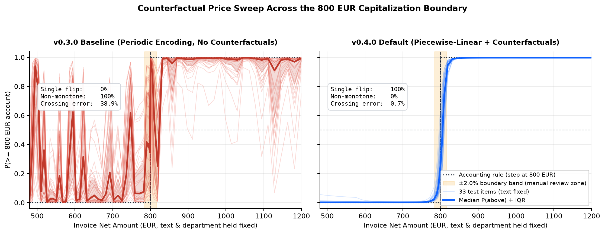

# ERP GL Account Classifier

A multimodal classifier that predicts general ledger (GL) accounts for ERP invoice lines from the product description, transaction amount, and department code together.



## The problem

Amazon Business invoices all carry the same vendor name. A €750 monitor and a pack of coffee pods both say "Amazon Services Europe", so the model has to look at the department, the amount, and the item description together to pick the right account.

IT hardware adds a price rule on top of the product category:
- **Below 800 EUR** -> `GL_6220` (operating expense)
- **800 EUR and above** -> `GL_1400` (capital expenditure)

A €750 monitor and an €850 monitor are the same physical product with different accounting treatment. A text-only classifier scores about 95% on this dataset because product titles already hint at the category and typical price tier, even though the model never sees the invoice amount. Hold the description fixed and vary the price from €700 to €900, and a text-only model predicts the same GL account every time.

### Why not write an `if amount >= 800` rule or call an LLM?

You can apply the 800 EUR rule directly once you know an invoice line is IT hardware, and the optional price band mode (`--price-band`, Config F) tests that exact two-stage setup. On raw ERP feeds, however, invoice lines do not arrive with a clean `IT_HARDWARE` tag: the model still has to infer the category from noisy, 40-character SAP text (`SAP_SGTXT`), multilingual descriptions (EN/DE/NL), and the department code. Calling a hosted LLM on every line item costs dollars per thousand invoices and returns uncalibrated confidence scores, whereas this 66.8M-parameter encoder runs locally in milliseconds on CPU or Apple Silicon and produces calibrated probabilities (ECE 0.046) for automated posting vs. human review.

## Architecture (v0.4.0)

We treat each transaction as a mix of text and tabular data, with a dedicated numerical branch for the invoice amount:

```
┌─────────────────────────┐      ┌──────────────────────────┐      ┌──────────────────────────┐
│  Text Features          │      │ Categorical Features     │      │ Continuous Features      │
│  vendor + description   │      │ department               │      │ [z_score, log1p(amt)]    │
└───────────┬─────────────┘      └──────────┬───────────────┘      └───────────┬──────────────┘
            │                               │                                   │
            ▼                               ▼                                   ▼
┌─────────────────────────┐      ┌──────────────────────────┐      ┌──────────────────────────┐
│ DistilBERT Encoder      │      │ Embedding Layer          │      │ Piecewise-Linear Encoding│
│ (pretrained)            │      │ dept → 32-dim            │      │ data-learned bin edges   │
│                         │      │ (with 15% UNK dropout)   │      │ 2-dim → 2 + 16 ramps     │
└───────────┬─────────────┘      └──────────┬───────────────┘      └───────────┬──────────────┘
            │                               │                                   │
            │                               │                                   ▼
            │                               │                       ┌──────────────────────────┐
            │                               │                       │ Numerical Projection     │
            │                               │                       │ 2-layer MLP: 18→64       │
            │                               │                       └───────────┬──────────────┘
            │                               │                                   │
            │                               └────────────┬──────────────────────┘
            │                                            │
            │                                            ▼
            │                               ┌──────────────────────────┐
            │                               │   FiLM Gating            │
            │                               │   γ, β = MLP(num+dept)   │
            │                               └──────────┬───────────────┘
            │                                          │
            └──────────────┬───────────────────────────┘
                           │
                           ▼
            ┌──────────────────────────────────────────┐
            │  Modulated Text: cls * (1+tanh(γ)) + β   │
            └──────────────┬───────────────────────────┘
                           │
                           ▼
            ┌──────────────────────────────────────────┐
            │   Fusion Classifier                      │
            │   [text, num, dept] → MLP → 8 GL codes   │
            │   864-dim → 256 → 128 → 8                │
            └──────────────────────────────────────────┘
```

Key design choices in v0.4.0:

1. **Piecewise-linear amount encoding.** The amount passes through monotone ramps between bin edges learned from the training data, so a higher amount can only push the score in one direction. This is the default; `--num-encoding periodic` in `train.py` restores the older sine/cosine encoder.
2. **Counterfactual training copies.** For each IT training record, the dataset builder adds 4 copies with the amount moved near the 800 EUR line and the label recomputed from the rules (`src/boundaries.py`). An original and its 4 copies share one unit of weight (1/5 each), so a product family still counts once. Use `--counterfactuals-per-record 0` in `build_dataset.py` to turn this off.
3. **Price scrubbing and grouped splits.** Explicit prices written into descriptions are stripped at build time and again at inference (`src/text.py`). Near-duplicate product titles stay in the same split so the test set cannot contain a twin of a training item.
4. **FiLM gating, department dropout (15%), and label smoothing (0.05).** Tabular features scale and shift the DistilBERT `[CLS]` embedding before final fusion, while modality dropout trains the `UNK` department embedding for missing metadata.

## Results

### Performance (v0.4.0)

Results come from 3 training seeds on one fixed split: 659 original training records plus 644 counterfactual copies, 141 validation records, and 141 test records (87 product groups in the test set).

- **Test accuracy:** 96.5% ± 0.6% (seed 42: 97.2%; macro F1 0.965; ECE 0.046)
- **Items within ±12.5% of 800 EUR:** 8 of 8 correct for every seed
- **Amount sweep** (33 IT test items, 70 amounts each, text held fixed): the prediction flips from OPEX to CAPEX once in 100% of cases and never flips back (0% non-monotone). It is right everywhere outside a ±2% band around the boundary, and the median first crossing lands 0.60% away from 800 EUR.

| Model | Test Accuracy | Near-Boundary | Single Flip | Tolerance Step (±2%) | Crossing Error |
|-------|---------------|---------------|-------------|----------------------|----------------|
| Majority class | 12.8% | 4/8 | n/a | n/a | n/a |
| Amount + department (GBDT) | 65.2% | 8/8 | 100% | 100% | 0.6% |
| TF-IDF + LR (text only) | 95.0% | 6/8 | 0% | 0% | n/a |
| TF-IDF + binned amount + dept (LR) | 96.5% | 8/8 | 100% | 100% | 1.3% |
| **Multimodal PLE + CF (default)** | **96.5%** | **8/8** | **100%** | **100%** | **0.6%** |

The counterfactual copies help the simple binned baseline as well as the neural model. The neural model locates the boundary about twice as precisely (0.6% vs 1.3% error) and scores higher across the sweep (94.8% vs 92.6%), while the two tie on overall test accuracy. Because the linear baseline is much cheaper to run, the neural model is worth the extra compute when you need smooth, monotone price behaviour and calibrated probabilities on noisy descriptions. Full ablation tables are in [`output/evaluation-multimodal/ablation_summary.md`](output/evaluation-multimodal/ablation_summary.md).

### Confidence routing

Selecting the lowest confidence threshold on validation that reaches 99% accuracy gives **0.90** (seed 42):
- **Auto-posted (`>= 0.90`):** 133 of 141 test items (94.3%), all correct (100% precision)
- **Sent to manual review (`< 0.90`):** 8 of 141 (5.7%), capturing €0 credit notes and items right on the 800 EUR boundary

### Optional: price band mode

Build the dataset with `--price-band` and a first step labels each amount as below or above the 800 EUR line using the accounting rules. The classifier reads that label as a `[PRICE_BAND]` token at the start of the text. The OPEX-to-CAPEX switch then lands right on 800 EUR instead of about 0.6% off, while overall test accuracy stays within noise (95.7% vs 96.5%). This mode is off by default because it hands the rule boundary to the model.

```bash
python scripts/build_dataset.py --input output/03_filtered.jsonl \
  --output-dir output/multimodal-band --price-band
```

Checkpoints trained on this data include a `price_band.json` file, and `classify_erp.py` applies it automatically. Details are in [BUILDING.md](BUILDING.md).

## Quick start

The repository includes the pre-generated dataset splits in `output/multimodal/`. Train a checkpoint locally (about 4 minutes on Apple Silicon; see [BUILDING.md](BUILDING.md)), then run the CLI or browser demo.

### Install

```bash
git clone https://github.com/EHTB/erp-classifier.git
cd erp-classifier
pip install -e .
```

### Command-line tool

Sweep a single item across the 800 EUR boundary:

```bash
python classify_erp.py --sweep 650:950:50
```

One-shot prediction with confidence routing:

```bash
python classify_erp.py \
  --vendor "Amazon Services Europe" \
  --description "Dell UltraSharp Monitor" \
  --department IT_OPS \
  --amount 850

# Output:
# ╭─────────────────────── Prediction ───────────────────────╮
# │ GL_1400_IT_HARDWARE_CAPEX                                │
# │ Confidence: 97.7%                                        │
# │ Routing:    AUTO-POST (confidence >= 90% validation      │
# │             cutoff)                                      │
# ╰──────────────────────────────────────────────────────────╯
```

Show all class probabilities and FiLM modulation stats:

```bash
python classify_erp.py \
  --vendor "Amazon Services Europe" \
  --description "Dell UltraSharp Monitor" \
  --department IT_OPS \
  --amount 750 \
  --show-all
```

Interactive prompt mode:

```bash
python classify_erp.py
```

### Browser demo (Gradio)

Launch the interactive web UI with preset invoice lines, an amount slider, FiLM gate diagnostics, and a live counterfactual sweep plot:

```bash
pip install -e ".[demo]"
python app.py
```

## Testing the 800 EUR threshold

Hold the vendor, description, and department fixed while changing the price across 800 EUR:

```bash
# Below threshold (750 EUR) -> OPEX
python classify_erp.py \
  --vendor "Amazon Services Europe" \
  --description "Dell UltraSharp Monitor" \
  --department IT_OPS \
  --amount 750
# -> GL_6220_IT_PERIPHERALS_OPEX (97.7% confidence, AUTO-POST)

# Above threshold (850 EUR) -> CAPEX
python classify_erp.py \
  --vendor "Amazon Services Europe" \
  --description "Dell UltraSharp Monitor" \
  --department IT_OPS \
  --amount 850
# -> GL_1400_IT_HARDWARE_CAPEX (97.7% confidence, AUTO-POST)
```

With the text and department unchanged, the prediction switches from `GL_6220` to `GL_1400` within about 1% of the 800 EUR line. Right on the boundary (800 to 801 EUR) confidence drops to 64% to 68%, so those invoices fall below the 0.90 cutoff and route to manual review.

## Building and training

For training instructions, synthetic data generation, and ablation reproduction, see [BUILDING.md](BUILDING.md) and [CHANGELOG.md](CHANGELOG.md).

## License

MIT

## Citation

```bibtex
@misc{erp-classifier,
  title={ERP GL Account Classifier: Multimodal Tabular-Text Classification},
  author={EHTB},
  year={2026},
  publisher={GitHub},
  howpublished={\url{https://github.com/EHTB/erp-classifier}}
}
```
